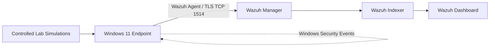

# Mini SOC Lab — Wazuh SIEM & Windows Endpoint Monitoring


A hands-on **Security Operations Center (SOC) lab** built to practice endpoint telemetry collection, SIEM deployment, custom detection engineering, and alert investigation using **Wazuh**, **Docker Compose**, and a **Windows 11 endpoint**.


## Overview

The lab deploys a single-node Wazuh stack in Docker and connects a Windows endpoint through the Wazuh Agent. Windows Security events are collected and analyzed to demonstrate two detection use cases:

- Repeated failed logons against a dedicated, non-existent lab username.
- Microsoft Office spawning a command interpreter or script host.

The project covers the workflow from telemetry generation to SIEM alert review and basic false-positive analysis.

## Architecture



| Component | Role |
|---|---|
| Windows 11 + Wazuh Agent | Endpoint telemetry source |
| Wazuh Manager 4.9.0 | Event decoding, rule matching, alert generation |
| Wazuh Indexer 4.9.0 | Stores and indexes security data |
| Wazuh Dashboard 4.9.0 | Search, filtering, and alert investigation |
| Docker Compose | Runs the single-node SIEM stack |

## Detection Use Cases

| Rule ID | Detection | Event | MITRE ATT&CK |
|---|---|---|---|
| `100001` | Intermediate match for failed logons to `fake_admin_account`; individual alert suppressed | 4625 | Correlation input |
| `100003` | Three matching failed-logon events within 60 seconds (configured threshold) | 4625 | [T1110 – Brute Force](https://attack.mitre.org/techniques/T1110/) |
| `100002` | Office application starts a command interpreter or script host | 4688 | [T1059 – Command and Scripting Interpreter](https://attack.mitre.org/techniques/T1059/) |


## Repository Structure

```text
mini-soc-wazuh/
├── docker-compose.yml
├── generate-indexer-certs.yml
├── config/
│   ├── certs.yml
│   ├── wazuh_cluster/
│   ├── wazuh_dashboard/
│   └── wazuh_indexer/
├── attack_scripts/
│   └── brute_force_simulation.ps1
├── rules/
│   └── custom_wazuh_rules.xml
├── screenshots/
│   ├── 4625_local.png
│   ├── 4625_wazuh.png
│   ├── 4688_local.png
│   ├── 4688_wazuh.png
│   ├── 100001_brute_force.png
│   └── 100002_powershell.png
└── README.md
```

## Quick Start

### Requirements

- Docker Desktop with Docker Compose
- Windows 11 endpoint
- Wazuh Agent compatible with the manager version
- Administrator access for Windows audit-policy configuration

### 1. Start the Wazuh stack

From the directory containing `docker-compose.yml`:

```powershell
docker compose up -d
docker compose ps
```

Open the dashboard at `https://localhost` after the services become healthy.

### 2. Connect the Windows endpoint

Install the Wazuh Agent and configure it to communicate with the manager. The endpoint-side agent configuration should collect the required Windows Security events:

- Event ID `4625` — failed logon
- Event ID `4688` — process creation

### 3. Enable Windows auditing

Enable failure auditing for **Logon** and success auditing for **Process Creation**. Confirm the effective settings with `auditpol` and verify that the corresponding events appear in Windows Event Viewer.

### 4. Load the custom rules

Copy `rules/custom_wazuh_rules.xml` to the manager's custom rules directory and restart the manager:

```powershell
docker cp rules/custom_wazuh_rules.xml <wazuh-manager-container>:/var/ossec/etc/rules/local_rules.xml
docker restart <wazuh-manager-container>
```


## Evidence

### Failed logon telemetry — Event ID 4625


### Process creation telemetry — Event ID 4688


### Office-to-interpreter custom alert — Rule 100002


## Project Roadmap

- [x] **Phase 1:** Environment architecture & auditing setup
- [x] **Phase 2:** Attack Simulation & Telemetry Generation
- [x] **Phase 3:** Custom Wazuh detection rules (XML & MITRE ATT&CK mapping)
- [x] **Phase 4:** Fine-tuning & false positive analysis
- [x] **Phase 5:** Incident report & Readme file

## Limitations

- Rule `100001` is hard-coded to one lab username and is not a general failed-login detection.
- Rule `100002` detects a parent-child process relationship; it does not prove malicious intent or inspect command-line arguments.

- The project is a local lab, not a high-availability or production SOC deployment.

## Detailed Report

See [`Mini_SOC_Technical_Report.pdf`](./Mini_SOC_Technical_Report.pdf) for the full architecture, implementation review, detection analysis, evidence assessment, security findings, and recommendations.

## References

- [Wazuh 4.9 Rules XML Syntax](https://wazuh-documentation-49-master.readthedocs.io/en/latest/user-manual/ruleset/ruleset-xml-syntax/rules.html)
- [Wazuh Rule Testing](https://documentation.wazuh.com/current/user-manual/ruleset/testing.html)
- [Microsoft Event 4625 — Failed logon](https://learn.microsoft.com/en-us/windows/security/threat-protection/auditing/event-4625)
- [Microsoft Event 4688 — Process creation](https://learn.microsoft.com/en-us/windows/security/threat-protection/auditing/event-4688)
- [MITRE ATT&CK T1110 — Brute Force](https://attack.mitre.org/techniques/T1110/)
- [MITRE ATT&CK T1059 — Command and Scripting Interpreter](https://attack.mitre.org/techniques/T1059/)
