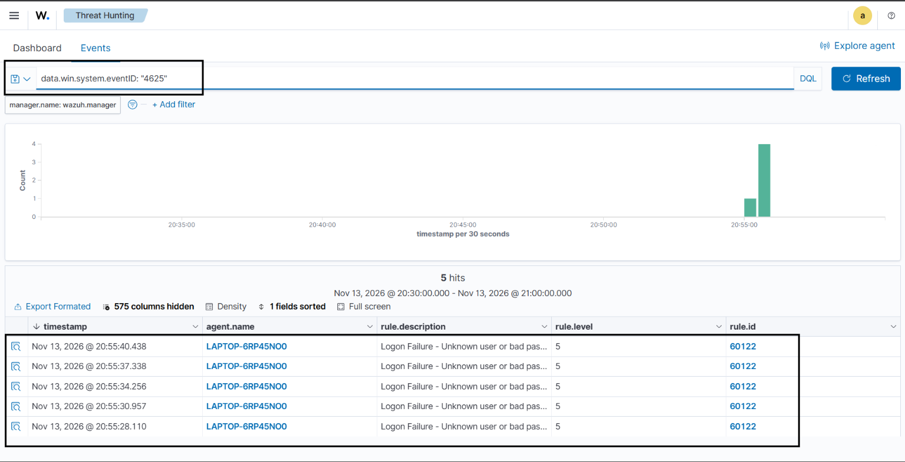
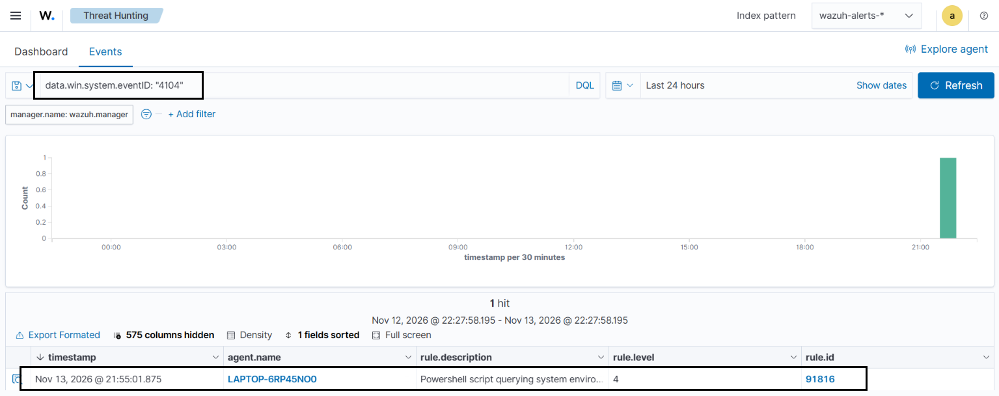

# Mini Security Operations Center (SOC) Lab: Endpoint Monitoring & Wazuh SIEM


---

## Project Overview

This project simulates the end-to-end deployment and configuration of an enterprise-style **Security Information and Event Management (SIEM)** platform using **Wazuh**, paired with a **Windows endpoint** configured for advanced security telemetry.

Instead of relying on default installations, the lab builds a solid monitoring foundation:

- Deploying a containerized Wazuh stack with Docker Compose
- Registering a secure host agent
- Enabling deep event auditing (failed logins and PowerShell Script Block Logging)
- Simulating attacker behavior to generate realistic telemetry
- Establishing a framework for custom detection engineering and incident triage

---

## Lab Architecture & Topology

| Component | Description |
|---|---|
| **SIEM Core** (Manager / Indexer / Dashboard) | Containerized single-node deployment running locally via Docker Compose |
| **Target Endpoint** | Windows host monitored by the Wazuh Agent service (`wazuhSvc`) |
| **Agent → Manager transport** | TLS-encrypted, TCP port `1514` (telemetry) and `1515` (registration) |
| **Web Dashboard** | HTTPS on port `443` |

**Primary telemetry sources**

- Windows Security **Event ID 4625**: failed logon attempts
- Windows PowerShell **Event ID 4104**: Script Block Logging

---

## Repository Structure

```text
mini-soc-wazuh/
├── docker-compose.yml             <-- Wazuh Docker stack blueprint
├── config/                        <-- Manager, Indexer, and Dashboard configs
├── attack_scripts/                <-- PowerShell attack simulation scripts
│   ├── brute_force_simulation.ps1     (Phase 2: generates Event ID 4625)
│   └── powershell_telemetry_test.ps1  (Phase 2: generates Event ID 4104)
├── rules/                         <-- Custom detection rules
├── reports/                       <-- Formal incident report PDFs
├── screenshots/                   <-- Wazuh dashboard evidence
└── README.md                      <-- Project documentation & architecture
```

---

## Phase 1: Environment Architecture & Telemetry Configuration

### Executive Summary

The first phase established the core infrastructure. A single-node Wazuh stack was containerized with Docker Compose, and a Windows agent was deployed and connected to the manager. Advanced host auditing policies were then enforced through command-line utilities and registry settings to capture high-fidelity logs for authentication failures and script executions.

### Infrastructure Profile

| Component | Value | Configuration Method / Tool |
|---|---|---|
| SIEM deployment model | Single-node stack | Docker Compose (`docker-compose.yml`) |
| Web dashboard | `https://localhost` | OpenSearch Dashboards (port 443) |
| Agent transport | TCP 1514 / 1515 | TLS-encrypted registration and data stream |
| Target OS | Windows 11 host | Wazuh MSI installer (`wazuh-agent-4.9.0-1.msi`) |
| Agent service | `wazuhSvc` | Windows Service Manager (`NET START`) |

---

### Step 1: Deploy the SIEM with Docker Compose
```powershell
docker compose up -d
```
---

### Step 2: Install the Windows Agent
The Wazuh Agent acts as an on-host sensor. It continuously reads Windows Event Logs and securely forwards them to the manager.

```powershell
Invoke-WebRequest -Uri "https://packages.wazuh.com/4.x/windows/wazuh-agent-4.9.0-1.msi" -OutFile "wazuh-agent.msi"
msiexec.exe /i "wazuh-agent.msi" WAZUH_MANAGER='127.0.0.1' /qn
NET START wazuhSvc
```

### Step 3: Enable Advanced Windows Auditing

**Why:** Default Windows configurations omit many events SOC analysts need. These two settings capture authentication failures and script execution in detail.

#### A. Failed Logon Auditing (`auditpol`)

Generates **Event ID 4625** whenever a logon fails (wrong password, account anomaly).

```powershell
auditpol /set /subcategory:"Logon" /failure:enable
```


#### B. PowerShell Script Block Logging (Registry)

Records the full, de-obfuscated content of each script block just before it runs, generating **Event ID 4104**. This helps defeat basic string obfuscation commonly used by attackers.

```powershell
New-Item -Path "HKLM:\SOFTWARE\Policies\Microsoft\Windows\PowerShell\ScriptBlockLogging" -Force
Set-ItemProperty -Path "HKLM:\SOFTWARE\Policies\Microsoft\Windows\PowerShell\ScriptBlockLogging" -Name "EnableScriptBlockLogging" -Value 1
```

---

## Phase 2: Attack Simulation & Telemetry Generation

### Executive Summary

With auditing enabled, the SIEM needs something to detect. Phase 2 simulates two common attacker behaviors on the Windows endpoint using harmless, self-contained PowerShell scripts, then verifies that the resulting events travel from Windows, through the Wazuh agent, into the dashboard. **Detections cannot exist without telemetry**, so this phase produces the raw data that Phase 3's custom rules will be built on.

| Simulation | Script | Attacker Behavior | Windows Event Generated |
|---|---|---|---|
| Brute-force login attack | `attack_scripts/brute_force_simulation.ps1` | Repeated password guessing | **4625** (account failed to log on) |
| Obfuscated PowerShell execution | `attack_scripts/powershell_telemetry_test.ps1` | Base64-encoded command execution | **4104** (Script Block Logging) |


### Step 1: Simulate a Brute-Force Login Attack

**Goal:** Generate **Event ID 4625** by repeatedly trying to log in as a non-existent user (`fake_admin_account`) with wrong passwords.

**How `brute_force_simulation.ps1` works:**

1. Defines the fake target username and a small list of wrong passwords.
2. Loops over each password and asks Windows to validate the credentials against the local account database.
3. Every failed validation makes Windows write a 4625 event.
4. Pauses 1 second between attempts to mimic a realistic automated tool.

No real account is touched, so no real account can be locked out.

---

### Step 2: Simulate Suspicious & Obfuscated PowerShell Execution

**Goal:** Generate **Event ID 4104**. Attackers frequently run Base64-encoded commands (`powershell.exe -EncodedCommand ...`) to evade command-line pattern matching.

**How `powershell_telemetry_test.ps1` works:**

1. Builds a harmless but suspicious-looking command string that mimics a payload download (`Invoke-WebRequest` fetching `fake_malware.exe` from `example.com`).
2. Converts that string to Unicode bytes, then to a Base64 string, the same technique malware droppers use.
3. Launches a child `powershell.exe` process that runs the encoded payload.
4. Windows decodes the payload in memory and logs the **decoded** script block as Event ID 4104.

---

### Step 3: Verify the Telemetry

#### A. Locally in Windows Event Viewer

**Via Applications and Services Logs → Microsoft → Windows → PowerShell → Operational** and look for **Event ID 4104**.

#### B. In the Wazuh Dashboard (Threat Hunting → Events)

Both event types were queried with DQL (Dashboards Query Language) filters on the `data.win.system.eventID` field.

**Failed logons: `data.win.system.eventID: "4625"`**

The query returned **5 hits**, one per password in the brute-force script, spaced about 3 seconds apart. Wazuh classified each as rule `60122` (*Logon Failure - Unknown user or bad password*, level 5) from the endpoint agent.



**Obfuscated PowerShell: `data.win.system.eventID: "4104"`**

The query returned **1 hit**, matching rule `91816` (level 4) from the same endpoint. This confirms Script Block Logging captured the encoded execution and the agent forwarded it to the manager.



### Phase 2 Outcome

Both attack simulations produced events that were visible locally in Event Viewer and centrally in Wazuh, which validates the full pipeline: **Windows auditing → Wazuh agent → Wazuh manager → Indexer → Dashboard**. This telemetry is the baseline for the custom detection rules in Phase 3.

---

## Project Roadmap

- [x] **Phase 1:** Environment architecture & auditing setup
- [x] **Phase 2:** Attack Simulation & Telemetry Generation
- [ ] **Phase 3:** Custom Wazuh detection rules (XML & MITRE ATT&CK mapping)
- [ ] **Phase 4:** Fine-tuning & false positive analysis
- [ ] **Phase 5:** Incident reports & portfolio assembly
