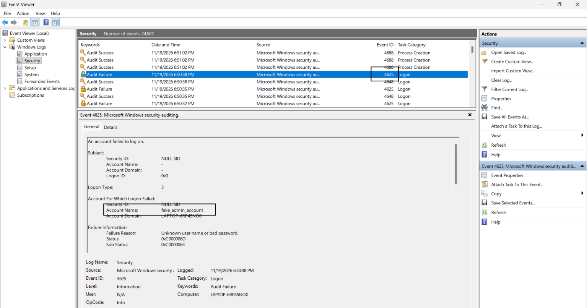
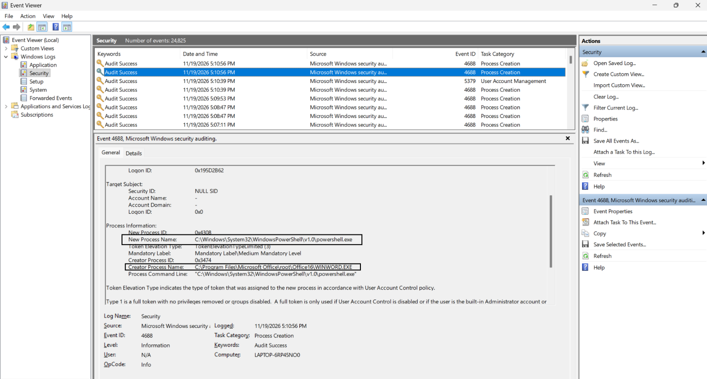
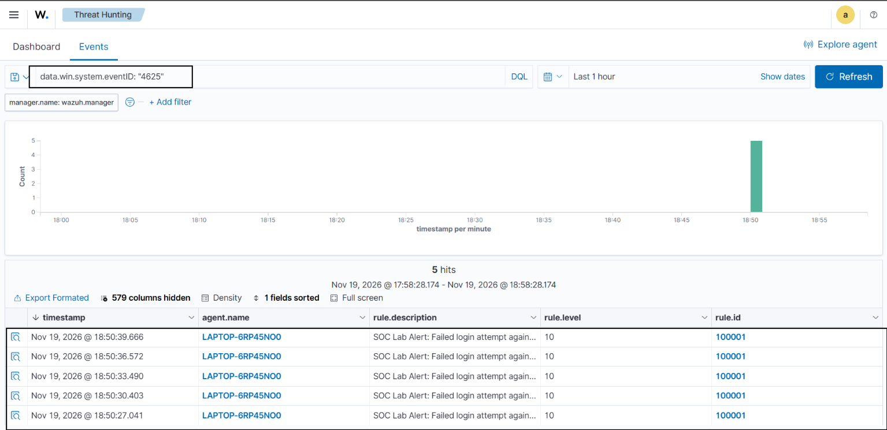
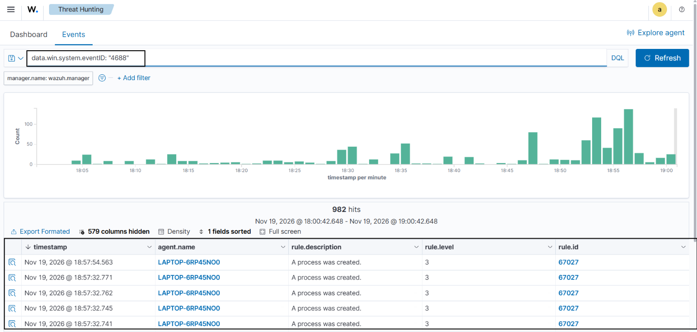
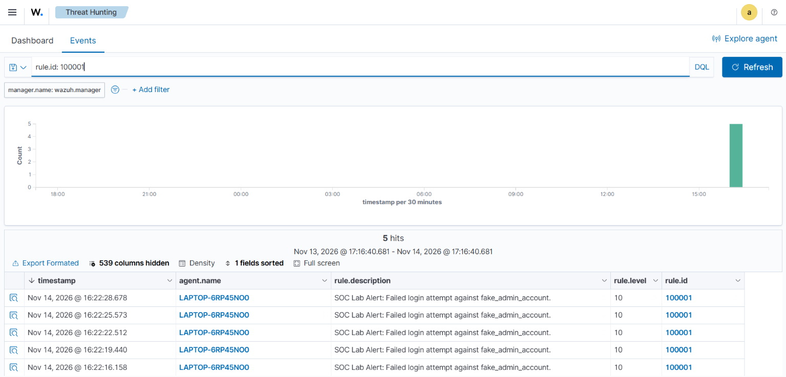
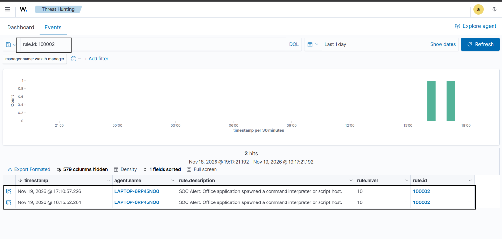

# Mini Security Operations Center (SOC) Lab: Endpoint Monitoring & Wazuh SIEM


---

## Project Overview

This project simulates the end-to-end deployment and configuration of an enterprise-style **Security Information and Event Management (SIEM)** platform using **Wazuh**, paired with a **Windows endpoint** configured for advanced security telemetry.

Instead of relying on default installations, the lab builds a solid monitoring foundation:

- Deploying a containerized Wazuh stack with Docker Compose
- Registering a secure host agent
- Enabling Windows security auditing for failed logons and process creation
- Simulating controlled security scenarios to generate Windows security telemetry
- Building a foundation for custom detection rules and security alert investigation

---

## Lab Architecture & Topology

| Component | Description |
|---|---|
| **SIEM Core** (Manager / Indexer / Dashboard) | Containerized single-node deployment running locally via Docker Compose |
| **Target Endpoint** | Windows 11 host monitored by the Wazuh Agent service (`Wazuh`) |
| **Agent → Manager transport** | TLS-encrypted, TCP port `1514` (telemetry) and `1515` (registration) |
| **Web Dashboard** | HTTPS on port `443` |

**Primary telemetry sources**

- Windows Security **Event ID 4625**: failed logon attempts
- Windows Security **Event ID 4688**: process creation (used by Rule 100002)

---

## Repository Structure

```text
mini-soc-wazuh/
├── docker-compose.yml             <-- Wazuh Docker stack blueprint
├── config/                        <-- Manager, Indexer, and Dashboard configs
├── attack_scripts/                <-- PowerShell attack simulation scripts
│   └── brute_force_simulation.ps1     (Phase 2: generates Event ID 4625)
├── rules/                         <-- Custom detection rules
├── reports/                       <-- Formal incident report PDFs
├── screenshots/                   <-- Wazuh dashboard evidence
└── README.md                      <-- Project documentation & architecture
```

---

## Phase 1: Environment Architecture & Telemetry Configuration

### Executive Summary

The first phase established the core infrastructure. A single-node Wazuh stack was containerized with Docker Compose, and a Windows agent was deployed and connected to the manager. Windows auditing was configured to capture authentication failures and process creation events.

### Infrastructure Profile

| Component | Value | Configuration Method / Tool |
|---|---|---|
| SIEM deployment model | Single-node stack | Docker Compose (`docker-compose.yml`) |
| Web dashboard | `https://localhost` | OpenSearch Dashboards (port 443) |
| Agent transport | TCP 1514 / 1515 | TLS-encrypted registration and data stream |
| Target OS | Windows 11 host | Wazuh MSI installer (`wazuh-agent-4.9.0-1.msi`) |
| Agent service | `wazuhSvc` | Windows Service Manager (`NET START`) |

---

### Step 1: Deploy the SIEM with Docker Compose
```powershell
docker compose up -d
```
---

### Step 2: Install the Windows Agent
The Wazuh Agent acts as an on-host sensor. It continuously reads Windows Event Logs and securely forwards them to the manager.

```powershell
Invoke-WebRequest -Uri "https://packages.wazuh.com/4.x/windows/wazuh-agent-4.9.0-1.msi" -OutFile "wazuh-agent.msi"
msiexec.exe /i "wazuh-agent.msi" WAZUH_MANAGER='127.0.0.1' /qn
NET START wazuhSvc
```

### Step 3: Enable Advanced Windows Auditing

**Why:** Default Windows configurations omit many events SOC analysts need. The lab uses Windows auditing to capture failed logons (Event ID 4625) and process creation (Event ID 4688). PowerShell Script Block Logging is retained as supplementary telemetry.

#### A. Failed Logon Auditing (`auditpol`)

Generates **Event ID 4625** whenever a logon fails (wrong password, account anomaly).

```powershell
auditpol /set /subcategory:"Logon" /failure:enable
```


#### B. PowerShell Script Block Logging (Registry)

This setting records PowerShell script block content as **Event ID 4104**. It remains an additional telemetry source in the lab, but the current Rule 100002 does not depend on Event ID 4104.

```powershell
New-Item -Path "HKLM:\SOFTWARE\Policies\Microsoft\Windows\PowerShell\ScriptBlockLogging" -Force
Set-ItemProperty -Path "HKLM:\SOFTWARE\Policies\Microsoft\Windows\PowerShell\ScriptBlockLogging" -Name "EnableScriptBlockLogging" -Value 1
```

#### C. Process Creation Auditing (Event ID 4688)

Event ID 4688 records when a new process is created. We verified that successful process creation auditing was enabled with:

```powershell
auditpol /get /subcategory:"Process Creation"
```

The output showed `Process Creation Success`. This telemetry is used by Rule 100002.

---

## Phase 2: Attack Simulation & Telemetry Generation

### Executive Summary

With auditing enabled, the SIEM needs events to analyze. Phase 2 generates failed logon events with a PowerShell simulation script and creates a real Word-to-PowerShell process relationship for the second test. We then verify that the resulting Windows events reach Wazuh through the agent and appear in the dashboard. **Detections cannot exist without telemetry**, so this phase produces the raw data used by Phase 3's custom rules.

| Simulation | Script | Attacker Behavior | Windows Event Generated |
|---|---|---|---|
| Failed login simulation | `attack_scripts/brute_force_simulation.ps1` | Attempts to authenticate with a fake, non-existent username and invalid passwords | **4625** (account failed to log on) |
| Office-to-interpreter process creation | Manual Word-to-PowerShell test | Microsoft Word starts `powershell.exe` | **4688** (process creation) |


### Step 1: Simulate a Brute-Force Login Attack

**Goal:** Generate **Event ID 4625** by attempting to authenticate as a non-existent user (`fake_admin_account`) with several invalid passwords.

**How `brute_force_simulation.ps1` works:**

1. Defines the fake target username and a small list of wrong passwords.
2. Loops over each password and asks Windows to validate the credentials against the local account database.
3. Every failed validation makes Windows write a 4625 event.
4. Pauses 1 second between attempts to mimic a realistic automated tool.

This controlled test targets a fake, non-existent username; it does not attempt to lock out a real account. It demonstrates failed-logon event collection, rather than testing a threshold-based brute-force detection algorithm.

---

### Step 2: Simulate Office application spawning an interpreter

**Goal:** Generate **Event ID 4688**, which records the creation of a new process. Our test checks whether Wazuh can identify Microsoft Word (`WINWORD.EXE`) starting PowerShell (`powershell.exe`).

**How the test works:**

1. Open a new Microsoft Word document.
2. Add a hyperlink that points to `C:\Windows\System32\WindowsPowerShell\v1.0\powershell.exe`.
3. Open the hyperlink to start PowerShell from Word.
4. Close the PowerShell window without entering any commands.

Windows records the new process in Event ID 4688. The event includes the parent process (`WINWORD.EXE`) and the newly created process (`powershell.exe`). This is the process relationship that Rule 100002 is designed to detect.

---

### Step 3: Verify the Telemetry

#### A. Locally in Windows Event Viewer

Open **Windows Logs → Security** and look for **Event ID 4625** entries matching `fake_admin_account` and **Event ID 4688** entries related to the Word-to-PowerShell test. For Event ID 4688, inspect **New Process Name** (`powershell.exe`) and **Creator Process Name** (`WINWORD.EXE`).




#### B. In the Wazuh Dashboard (Threat Hunting → Events)

The two event types were checked in **Threat Hunting → Events** using DQL filters on the `data.win.system.eventID` field.

**Failed logons: `data.win.system.eventID: "4625"`**


The query returned **5 hits**, one for each failed authentication attempt generated by the simulation. Wazuh classified these as rule `60122` (*Logon Failure - Unknown user or bad password*, level 5) from the endpoint agent.


**Process creation: `data.win.system.eventID: "4688"`**



The query returned Windows process creation events matched by Wazuh's built-in rule `67027` (*A process was created*, level 3). The relevant test event showed Word as the parent process and PowerShell as the newly created process.


### Phase 2 Outcome

Both tests produced events that were visible locally in Event Viewer and centrally in Wazuh, validating the pipeline: **Windows auditing → Wazuh agent → Wazuh manager → Indexer → Dashboard**. Event ID 4625 provides the failed-logon telemetry for Rule 100001, while Event ID 4688 provides the process-creation telemetry for Rule 100002.

---

## Phase 3: Custom Wazuh Detection Rules (XML) & MITRE ATT&CK Mapping

### Executive Summary

Phase 2 proved that the events reach the SIEM, but Wazuh's built-in rules only describe them generically (for example, "Logon Failure - Unknown user or bad password"). Phase 3 turns raw telemetry into **purpose-built detections**: two custom XML rules that recognize the lab's simulated attacks, raise them at a higher severity with a clear alert message, and tag them with the matching **MITRE ATT&CK** technique so an analyst immediately knows *how* the attacker operates.

| Rule ID | Detects | Trigger Event | Severity | MITRE ATT&CK Technique |
|---|---|---|---|---|
| `100001` | Failed logon attempts against `fake_admin_account` | Windows Event ID **4625** | **10** (High) | **T1110**: Brute Force |
| `100002` | An Office application starts a command interpreter or script host | Windows Event ID **4688** | **10** (High) | **T1059**: Command and Scripting Interpreter |


### Step 1: Write the Custom Rules File

The rules live in `rules/custom_wazuh_rules.xml`. Both rules sit inside one group and follow the same structure.

**Rule 100001: Failed-logon detection**

It uses the Builds on the parent rule 60106 (Windows Security events). It fires only when the event ID is 4625 and the log contains fake_admin_account, so it catches the failed-logon flood from brute_force_simulation.ps1. Severity is 10 (high) and it is mapped to T1110 (Brute Force).

**Rule 100002: Office-to-interpreter process creation detection**

Builds on Wazuh's built-in rule `67027`, which recognizes Windows process creation events. It checks whether the parent process is a Microsoft Office application (`WINWORD.EXE`, `EXCEL.EXE`, `POWERPNT.EXE`, or `OUTLOOK.EXE`) and whether the newly created process is a command interpreter or script host. Severity is **10 (high)** and it is mapped to **T1059 (Command and Scripting Interpreter)**.

---

### Step 2: Deploy the Rules to the Wazuh Manager

The manager runs inside Docker, so the rules file is copied into the container at the path Wazuh reads custom rules from, then the manager is restarted to load them.

```powershell
docker cp rules/custom_wazuh_rules.xml mini-soc-wazuh-wazuh.manager-1:/var/ossec/etc/rules/local_rules.xml
docker restart mini-soc-wazuh-wazuh.manager-1
```

### Step 3: Test and Verify the Custom Alerts

With the rules live, we ran `brute_force_simulation.ps1` for Rule 100001 and performed the manual Word-to-PowerShell test for Rule 100002. The resulting alerts were checked in the Wazuh Dashboard under **Threat Hunting → Events** by filtering on the custom rule IDs.

**Brute-force alerts: `rule.id: 100001`**



The query returned **5 hits**, one per failed login attempt. Each alert carries the custom description *"SOC Lab Alert: Failed login attempt against fake_admin_account."* at **level 10**, instead of the generic level 5 alert seen in Phase 2.

**Office-to-interpreter alerts: `rule.id: 100002`**



The query returned **1 hit** for the verified Word-to-PowerShell test. The alert carries the custom description *"SOC Alert: Office application spawned a command interpreter or script host."* at **level 10**. The event details show `WINWORD.EXE` as the parent process and `powershell.exe` as the new process.


### Phase 3 Outcome

The two tested behaviors now trigger **custom alerts with clear descriptions, higher severity levels, and MITRE ATT&CK context**. Rule 100001 identifies failed logons against the specified fake username, while Rule 100002 identifies the specified Office-to-interpreter process relationship. This completes the loop of **telemetry → detection → mapped technique**.

---

## Project Roadmap

- [x] **Phase 1:** Environment architecture & auditing setup
- [x] **Phase 2:** Attack Simulation & Telemetry Generation
- [x] **Phase 3:** Custom Wazuh detection rules (XML & MITRE ATT&CK mapping)
- [ ] **Phase 4:** Fine-tuning & false positive analysis
- [ ] **Phase 5:** Incident reports & portfolio assembly
